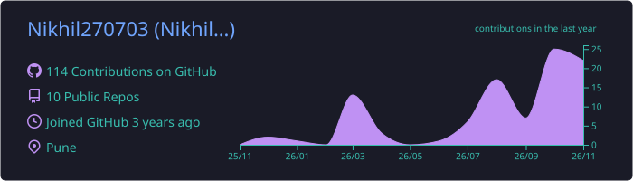
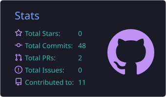
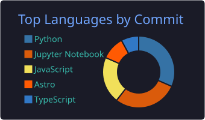

**B.Tech Computer Science & Engineering (AI)** · Nutan College of Engineering and Research, Pune · Class of 2026

---

### 🧑‍💻 About me

- 🚀 Founder of **[Nexvhira](https://nexvhira.vercel.app/)**, a Pune software studio building billing, stock, ERP and AI tools for small businesses in English and मराठी.
- 🔭 I build **AI and full-stack products for real users**: legal-judgment prediction, the live **Tammewar Pharmacy** ERP, the **AuraEdu** institution suite and a bilingual **Flour Mill** app.
- 🧠 Interested in **Applied AI, NLP and LegalTech**; currently learning **advanced deep learning** and **Explainable AI (SHAP)**.
- 💼 Former **Java Application Developer Intern** at MRND Lab Pvt. Ltd. (Jan – Mar 2024).
- 🎤 Main anchor for my college fest (500+ audience) · first place in speech competitions · **Top 5 nationally** at the VOIS Innovation Marathon 2.0.

---

### 🚀 Featured projects

| Project | What it does | Built with |
|:--|:--|:--|
| ⚖️ **[Legal Case Outcome Prediction](https://github.com/Nikhil270703/AI-For-legal-case-outcome-prediction)** | Predicts Indian court outcomes with fine-tuned InLegalBERT (**85.2% accuracy**, +23.2 pts over baseline) and maps IPC → BNS sections | Python · PyTorch · Hugging Face · Streamlit · Supabase |
| 💊 **[Tammewar Pharmacy](https://tammewar-pharmacy.pages.dev/)** · [code](https://github.com/Nikhil270703/medical_stock_system) | **Live** pharmacy distribution ERP for Naresh Enterprises: stock, purchases, PDF bills, dues, deliveries, WhatsApp reminders | React · Express · MongoDB · JWT |
| 🎓 **[AuraEdu](https://aura-edu-eight.vercel.app/)** · [code](https://github.com/Nikhil270703/AuraEdu) | **Live** institution suite for coaching centres, schools and colleges: admissions, attendance, tests, fees, payroll | Next.js · TypeScript · MongoDB |
| 🌾 **[Flour Mill Manager](https://feed-mill-management-system.vercel.app/)** · [code](https://github.com/Nikhil270703/Feed-Mill-Management-System) | **Live** मराठी / English orders and dues app with an installable customer portal, UPI QR and 2FA | Next.js · TypeScript · MongoDB · Zod |
| 🤖 **[ML Projects](https://github.com/Nikhil270703/Machine-Learning-Projects)** | Cat vs Dog CNN, SMS spam classifier, health-cost regressor and KNN book recommender | TensorFlow · Keras · scikit-learn |

---

### 🛠️ Tech stack

| | |
|:--|:--|
| **Languages** |  |
| **AI & ML** |  |
| **Frontend** |  |
| **Backend & data** |  |
| **Tools & cloud** |  |

**Also:** Hugging Face (InLegalBERT) · Keras · Pandas · NumPy · Streamlit · Java Swing · Power BI · IBM Watson Studio

---

### 📜 Certifications

| Certificate | Issuer |
|:--|:--|
| [Machine Learning with Python](https://freecodecamp.org/certification/Nikhil_Raghuwanshi/machine-learning-with-python-v7) (300 hours) | freeCodeCamp |
| Introduction to Machine Learning | NPTEL · IIT Madras |
| SQL (Advanced) | HackerRank |
| Core Java Programming (60 hours) | Diamond Mindglance Institute |
| Intro to LLMs · Ethics of Generative AI | IBM SkillsBuild |
| ML Performance Evaluation · Cyber Security · Blockchain · Power BI | VOIS |

➡️ All 19 certificates on my **[portfolio](https://nikhilraghuwanshi.live/#certifications)**.

---

### 📊 GitHub stats

  

  
  

  

---

### 🐍 Contribution snake

<picture>
  <source media="(prefers-color-scheme: dark)" srcset="https://raw.githubusercontent.com/Nikhil270703/Nikhil270703/output/github-snake-dark.svg" />
  <source media="(prefers-color-scheme: light)" srcset="https://raw.githubusercontent.com/Nikhil270703/Nikhil270703/output/github-snake.svg" />
  
</picture>

---

**📫 Let's connect:** [nraghuvanshi100@gmail.com](mailto:nraghuvanshi100@gmail.com) · [LinkedIn](https://www.linkedin.com/in/nikhil-raghuwanshi-8a7704259/) · [Portfolio](https://nikhilraghuwanshi.live) · [Nexvhira](https://nexvhira.vercel.app/)

